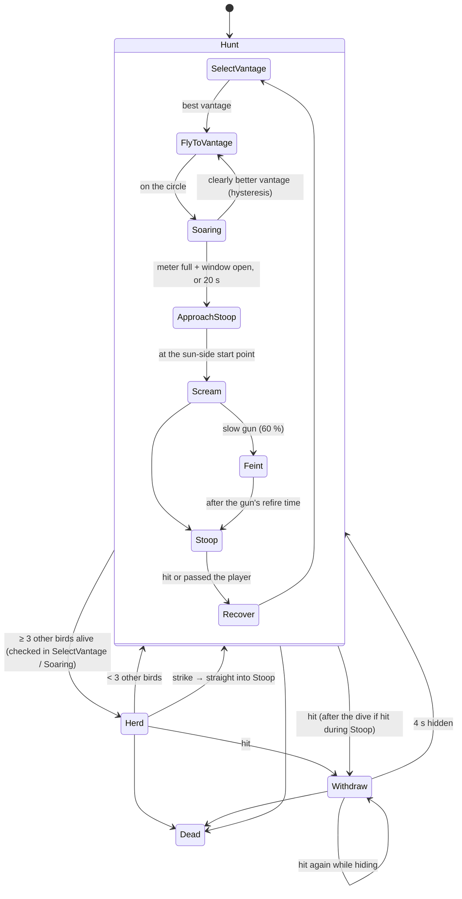

# Hawk AI — design notes, formulas and playtest numbers

Owner: Basidh (Hawk IS owner). Code: `Assets/_Project/Scripts/Agents/Hawk/`. Numbers: `ScriptableObjects/Birds/Strategy/HawkStrategyConfig.asset`.
Plan: `04_HAWK_PLAN.md` phases H1–H7 (outside the repo). This file records what was built, why, and where it differs from the plan.

**Strategy in one line:** an ambush predator that watches from the best vantage point, reads the player for moments of weakness, learns which ones this player shows most, and dives out of the sun — with fair warnings (shadow, scream, hover).

**AI techniques**

| Technique | Where |
|---|---|
| Hierarchical finite state machine (modes → hunt phases) | `HawkBrain`, `HawkStates` |
| Utility AI (weighted scoring of vantage points) | `PerchSelector`, `PerchMemory` |
| Event-driven opponent modelling with per-player learning | `PlayerWeaknessModel`, `WeaknessWindow` |
| A\* on a 3D voxel flight grid (shared F1) | `RequestPath` → `PathService` |
| Multi-agent influence (fear field read by other species) | `HawkFearSource` → `FearRegistry` |

---

## 1. State machine (H1)

Two levels: the **mode** decides what the hawk is doing overall; **Hunt** has its own phases. Every mode and phase has an enter step, an exit step and its own timer (`ChangeMode` / `ChangePhase`).



The label above the bird shows the state, e.g. `Hunt/Soaring  meter 60 [Reloading]`, `Withdraw/Hiding`, `Herd  meter 30 [Busy]`.

**Design change (17 Oct): the hawk never lands.** The plan's "perches" are vantage points it **soars over** (4 m up, 7 m radius). A still bird is too easy to shoot, and the shared `BirdMotor.LandAt` can orbit its landing point forever (reported in `Docs/IS/HANDOFF.md`).

## 2. Choosing a vantage point (H2, utility AI)

Every `BirdPoint` of type Perch gets a score; the highest wins.

```
height   = clamp01((vantage.y − player.y) / 15 m)
sight    = 1 if a ray from 4 m above the vantage reaches the player's head, else 0   (birds and the player don't block it)
distance = exp(−((d − 25 m) / 10 m)²)                                                (bell curve around 25 m)
sun      = clamp01(dot(direction player→vantage, −sunForward))                       (1 = the hawk is in the sun for the player)
shot     = PerchMemory value 0..1                                                    ("I was shot here", H5)

Hunt:     total = 0.35·height + 0.45·sight + 0.20·distance + 0.15·sun − 0.40·shot
Withdraw: total = 0.35·height − 0.45·sight + 0.20·distance            − 0.40·shot
```

- **Sight weight 0.45, not the plan's 0.30:** at 0.30, a vantage that could not see the player could still win on sun + distance (playtest 17 Oct).
- **Hysteresis 0.15 + commit time 4 s:** a new vantage must beat the current one by more than 0.15, and not within 4 s of the last choice. Without them the sight term flips every time the player steps behind a wall, and the hawk zig-zags between two vantage points.
- Re-scoring runs every 2 s (not every frame): one raycast per vantage point.

## 3. Reading the player (H3)

`PlayerWeaknessModel` listens to `PlayerEventHub` events. Each **weakness window** adds to an **aggression meter** (0–100). With no window open, the meter decays by 10/s.

| Window | Opens on | Meter |
|---|---|---|
| Reloading | reload started → finished | +40 once |
| SwitchingWeapon | weapon equipped, 0.8 s | +30 once |
| InteractingDoor | door used, 1.2 s | +35 once |
| PushingBarricade | any barricade being pushed | +20/s |
| ShieldExpired | shield ran out, 2 s | +30 once |
| LookingAway | camera > 100° away from the hawk for ≥ 1.5 s | +25/s |
| LowHealth | HP < 35 % | +20/s |
| Busy (Herd mode only) | the player fired in the last 2 s | +15/s |

**Learning (per player, kept across waves):** every bonus is multiplied by that window's weight

```
weight(w) = clamp(1 + 0.15 · openCount[w] / max(1, average(openCount)), 1, 2)
```

so a window this player opens more often than their others fills the meter faster. Capped at 2× so the hawk never becomes unbeatable.

**Attack rule:** meter full **and** a window open now → attack. Never passive: after 20 s of soaring it attacks anyway (15 s before the 18 Oct tuning). While the player's health is low the meter rises 10/s (was 20).

## 4. Stoop and feint (H4)

- **Sun-side start point:** `start = player − sunForward × 25 m`, at least 12 m above the player. The dive angle is capped at 28° (the motor pitches ≤ 30°). If a building blocks the dive line, the start is rotated around the player in steps until the line is clear.
- **Tells (fairness):** the hawk's shadow is forced on (it sweeps towards the player), it hovers 0.9 s with wings tucked (0.5 s before the 18 Oct tuning), and it screams (if a clip is set).
- **Dive:** 2.5× speed, aimed at the chest — where the player is now, no lead since the 18 Oct tuning (was 0.3 s of the player's velocity) — through the player and 8 m beyond. A hit deals 1.25× the species damage (was 1.5×). *Turn first, then dive:* it speeds up only once it is within 30° of the player, because the turn circle grows with speed (r = v / ω).
- **Ground guard:** levelling out from angle θ drops r·(1 − cos θ). If that (× 1.5) would go below the player's feet + 1.5 m, the hawk only pulls up.
- **Feint (slow guns only, fire interval ≥ 0.75 s, 60 % chance, once per engagement):** the fake dive aims 6 m above the chest, so it physically cannot come closer. Then the hawk circles out of reach for the gun's refire time and dives for real. The point: bait a shot, then hit while the gun reloads. Fast guns (pistol, AR) are never feinted — there is no refire gap to exploit.

## 5. Wounded withdrawal (H5)

On every hit that doesn't kill:

1. **Remember:** the vantage it last watched from gets +0.6 "shot" value (capped at 1). It fades by 0.01/s and is cleared when a wave starts.
2. **Hide:** score every vantage with the **withdraw** formula (sight is a penalty, sun ignored), fly there at 1.3× speed (`Withdraw/ToCover`), circle it for 4 s (`Withdraw/Hiding`), then hunt again.
3. A hit during the **real dive** lets the dive finish first; a hit during the **feint** breaks it off (the bait failed). A hit **while hiding** marks that spot too and picks another. A hit **on the way** to the hiding spot changes nothing — it keeps fleeing.

**Why hits on the way are ignored (playtest 17 Oct):** at first every hit marked the current target and re-selected. Two hits 0.3 s apart marked two hidden spots the hawk had not even reached, and its next retreats had to go to spots that can see the player. The pistol fires every 0.33 s, so a real player would do this every time. Being hit while fleeing says nothing about the hiding spot.

**Why 0.01/s, not the plan's 0.05/s:**

| Decay | One hit (0.6) gone after | Penalty when it hunts again (~14 s later) | Effect |
|---|---|---|---|
| 0.05/s | 12 s | 0.40 × max(0, 0.6 − 0.7) = **0** | goes straight back to the vantage where it was shot |
| **0.01/s** | 60 s (two hits: 100 s) | 0.40 × 0.46 = **0.18** | picks a different vantage |

## 6. Herding with a fear field (H6)

- **When:** checked every 1 s while choosing or watching from a vantage: ≥ 3 other living birds (not hawks) → `Herd`; fewer → back to `Hunt`.
- **Where:** `herdPoint = centroid + flat(centroid − player).normalized × 10 m`, 6 m above the flock — the far side of the flock from the player. It circles there (7 m radius) and re-plans its A\* path only when the herd point moves > 5 m.
- **Fear field:** while herding, `HawkFearSource` (radius 12 m, strength 1.5) is registered in `FearRegistry`. Pigeons and crows read `FearRegistry.GetRepulsion` in their steering and `FearCostModifier` in their A\* searches, so they are pushed away from the hawk — towards the player. Neither side references the other's classes: the registry + `IFearSource` interface is the whole contract (loose coupling).
- **Strike:** "Busy" becomes a window (the player is shooting at the flock). Meter full + window open (or 20 s) → `Scream` (hover + scream), then `Stoop` from where it is — no vantage, no sun approach; the flock is the cover. Until the 18 Oct tuning it went straight into `Stoop` with no tell.
- **Herd orbit radius 7 m, not the plan's 4 m:** the hawk's turn circle is v / ω = 8 m/s ÷ 90°/s ≈ 5.1 m, so it cannot fly a 4 m circle.
- ⚠ **Status (17 Oct):** no pigeon or crow brain reads the fear field yet (the crow branch has only its config), so herding has **no visible effect on other birds** — only the hawk's side is done. Tuning to revisit then: with the herd point 10 m behind the flock and a 7 m orbit, the flock centre is 7–18 m from the hawk, so the 12 m field reaches it only on the near half of the circle.

## 7. Plan deviations (for the viva)

| Plan | Built | Why |
|---|---|---|
| Lands on perches | Soars over vantage points, never lands | A still hawk is too easy to shoot; `BirdMotor.LandAt` orbit bug |
| `wLineOfSight` 0.30 | 0.45 | Blind vantage points could win on sun + distance |
| No commit time | 4 s commit + 0.15 hysteresis | Stops flip-flopping when the player steps in/out of view |
| Stoop from 25 m at any angle | Dive ≤ 28°, turn first then dive, ground guard, strike-through 8 m | Real motor: turn 90°/s, pitch ≤ 30° |
| Feint pulls up at 6 m | Aims 6 m above the chest | A turn-limited bird can't be trusted to pull up on command |
| `recentlyShotDecayPerSecond` 0.05 | 0.01 | Section 5 |
| Every hit marks the perch and withdraws | Hits while already fleeing are ignored | Section 5 (fast guns poisoned every hiding spot) |
| `herdOrbitRadius` 4 m | 7 m | Section 6 |
| `HawkFearSource` component | Plain object owned by `HawkBrain` | No prefab change needed; others only see `FearRegistry` |
| Herd strike dives straight in | Screams first, like every other dive | Section 8A: no-tell dives were the hardest to survive; the wave hint says "when it screams, look up" |
| Stoop leads the player by 0.3 s | No lead (aims where the player is) | Section 8A: a sprint after the scream should be a real dodge |
| Scream hover 0.5 s, stoop damage × 1.5, max watch 15 s, low-HP meter 20/s | 0.9 s, × 1.25, 20 s, 10/s | Section 8A: first real-shooting playtest, the hawk was too hard |

## 8. Measured (sandbox `Sandbox_IS_Hawk`, 17 Oct, final tuning)

From `Logs/Editor.log` (`[HawkFSM]` lines), 4 play sessions with the final motor tuning. ⚠ The player could **not** aim or shoot (player/gun animations not built yet), so these are against a player who does not dodge or fire.

| Measure | Value |
|---|---|
| Real dives with a result | 8 — **6 hits, 2 misses (75 %)** |
| Dives right after a feint | 3 / 3 hit |
| Dives without a feint | 3 / 5 hit (60 %) |
| Feints flown | 4 — closest approach 6.6, 8.8, 5.8, 5.7 m (never within the 6 m pull-up) |
| Feints that baited a shot | 0 (the player could not shoot) |
| Attacks by meter / by 15 s timeout | 4 / 5 |
| Soaring time before a meter attack | 0.0, 14.1, 4.5, 1.1 s |
| Dive speed at the hit | 9–16 m/s |
| Lowest point in a dive (earlier run) | 4.0 m — never below the ground guard |

**Withdrawal and herd test (17 Oct, `H` key hits, 5 pigeons without brains):**

| Check | Result |
|---|---|
| Hit while soaring → withdraw | ✅ vantage marked 0.60, hides over a vantage with `sight 0` |
| Hunts again from a different vantage | ✅ shot at ControlTower → hunted from ShelterB_Roof |
| Repeated hits on one vantage add up | ✅ 0.60 → 0.91 |
| Hit during Recover → withdraw | ✅ |
| 5 other birds → Herd | ✅ circled 10–12 m behind the flock (seen from the player); meter rose with `[Busy]` while the player fired |
| Herd strike | ✅ after 15 s, dived from 46 m, hit after 2.4 s at 14 m/s |
| Session counters | 8 hits taken, 8 withdrawals, 2 dives / 2 hits, 1 herd strike |
| Not yet tested | hit during the dive (should finish first), hit during a feint, fear field on other birds (no consumer yet) |

**Still to measure** (needs the player's aiming/shooting): feint bait rate and hit rate during the refire, how fast the learned weights climb (reload-only play), and the hawk's script time in the Profiler (target < 0.2 ms per frame; scoring runs every 2 s, not per frame). Each session ends with one `[HawkStats]` line in the log with all counters.

## 8A. Difficulty tuning (18 Oct, first playtest with real shooting)

**Problem:** the first wave-4 playtest in `Main` with real aiming/shooting felt too hard. The three `[HawkStats]` lines of that session:

| Measure (3 hawks, `Main`, wave 4) | Before |
|---|---|
| Dives with a result | 10 — **8 hits (80 %)**, 30 damage each |
| Of those, herd strikes (no tell) | 6 of 10 |
| Feints / baited a shot | 2 / 1 |
| Hits the player landed on hawks | 4 |

**Target:** dive hit rate around **50 %** against a player who reacts to the scream (a player who stands still is still hit), and no attack without a tell.

**Method:** only the hawk's own strategy numbers and brain were changed — not the species data (HP 300, damage 20, speed 8, cooldown: Systems Engineer), not the motion profile (`BirdMotion_Hawk`: Agent Controller), not the wave. One change per cause:

| Cause seen in the log | Change | Effect expected |
|---|---|---|
| 6 of 10 dives were herd strikes with no scream | Herd strike → `Scream` → `Stoop` | Every dive is announced (sound + hover + shadow) |
| Running sideways did not help (lead aim) | `stoopLeadTime` 0.3 → 0 | A sprint after the scream makes the dive miss; at 20 m/s the turn circle (~13 m) is too wide to correct late |
| Too little time to find the hawk after the scream | `screamHoverTime` 0.5 → 0.9 s | Time to turn and aim; the hovering hawk is the RPG's best target |
| One hit snowballed (low HP → meter fills → next dive) | `lowHpPerSecond` 20 → 10 | The low-health window still helps the hawk, but half as fast |
| Three hawks attacking every ≤ 15 s | `maxWatchTime` 15 → 20 s | Fewer timeout attacks |
| 30 damage per hit | `stoopDamageMultiplier` 1.5 → 1.25 (25) | One more dive survivable |

The model was also scaled **1.0 → 1.3** (0.73 m long, 1.96 m wingspan; gull 1.66 m) so the boss reads as the biggest bird; its body collider (hitbox) grows with it (radius 0.12 → 0.156 m). No distance in the brain depends on the model size (all are world metres), and the contact range (2 m, pivot to the player's collider) is unchanged.

**After:** _to measure — play wave 4 in `Main` and copy the `[HawkStats]` lines here._

## 9. Testing in the sandbox

- `Tools > IS > Hawk > Place Sandbox Perches` — 8 vantage markers (positions from `Main`'s greybox).
- `Tools > IS > Hawk > Add Hawk Test Tools` — the debug overlay and a pigeon spawner.
- **B** spawns the hawk · **N** spawns 5 pigeons (≥ 3 → Herd) · **H** hits the hawk for 1 damage (never lethal; withdrawal test) · **F4** shows/hides the overlay (meter, windows, learned weights, vantage score, counters).
- Select the hawk in Play mode: gizmos show every vantage score (H/L/D/S/X), the soaring circle, the sun ray + stoop start + dive line, and in Herd mode the flock centre, herd point and fear sphere.

**Screenshots to capture:** vantage score labels · stoop line from the sun · withdrawal to a hidden vantage · herd gizmo with the fear sphere · the overlay after a long session (learned weights).
